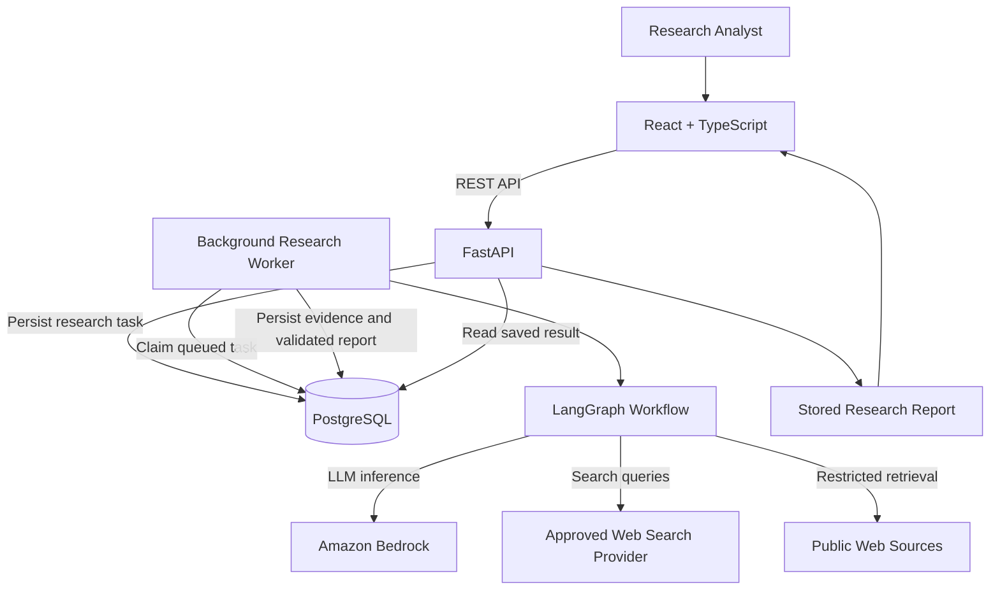
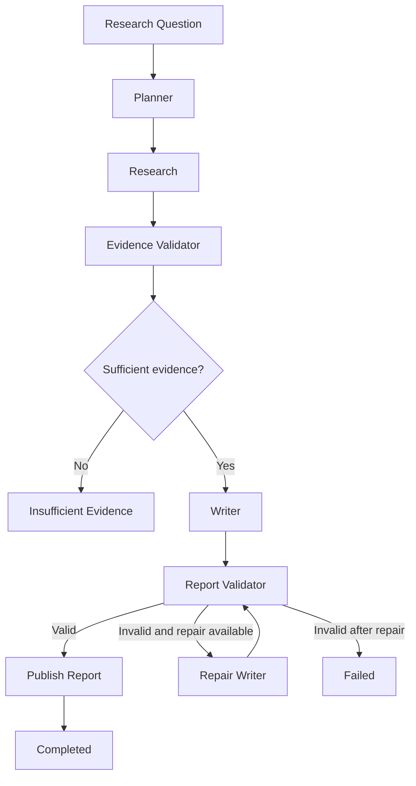

# AgentOps AI

### Evidence-Grounded Agentic Market & Competitor Research Platform

**Production-Oriented AI Engineering Portfolio Project**

AgentOps AI is an AI-powered research platform designed to help market analysts investigate competitors, products, and industry trends through a structured, evidence-grounded research workflow.

The platform is designed to combine **LangGraph-based AI orchestration**, controlled web research, verifiable citations, and a modern full-stack application to produce structured reports that users can inspect and evaluate.

Rather than relying on a single unconstrained LLM response, AgentOps AI is designed around specialized research steps, explicit evidence validation, persistent execution state, and measurable AI quality.

> **Project status:** Sprint S00 — Product Planning & Architecture. This repository currently establishes the planned product and engineering foundation. The application, automated tests, cloud deployment, and AI quality targets have not yet been verified.

---

## 1. Project Overview

Market and competitor research requires collecting information from multiple sources, comparing claims, tracking source credibility, and transforming findings into actionable reports.

Traditional research workflows can be time-consuming and difficult to reproduce. General-purpose AI systems may accelerate analysis, but they can also produce unsupported claims, fabricated citations, or results that are difficult to audit.

AgentOps AI is designed to address these challenges through:

- Structured research planning.
- Controlled external information retrieval.
- Specialized LangGraph workflow components.
- Persistent evidence and source metadata.
- Deterministic citation-reference validation.
- Transparent reporting of uncertainty and limitations.
- Observable, bounded background execution.
- Reproducible AI evaluation.

### Product Objective

Enable users to submit a research question and receive a structured, evidence-backed report while retaining the ability to verify the information used to generate its findings.

### Intended Users

- Market Research Analysts
- Competitive Intelligence Analysts
- Product Managers
- Business Strategy Teams

The initial MVP supports individual authenticated accounts. Shared workspaces and advanced enterprise collaboration are outside its initial scope.

---

## 2. Planned Features

### Research Management

- User authentication and resource ownership.
- Research task creation with optional scope.
- Asynchronous research execution.
- Task status and execution-stage tracking.
- Research history and report viewing.
- Explicit retries and safe failure handling.

### Agentic AI Research

- Structured planning through a Planner component.
- Research execution through approved search and retrieval adapters.
- Evidence normalization and validation.
- Structured report generation through a Writer component.
- Schema and citation-reference validation.
- Bounded repair when generated output is invalid.
- Transparent handling of insufficient evidence.

### Evidence and Reports

- Persistent source metadata.
- Stable evidence identifiers.
- Citation-to-evidence traceability.
- Clear separation of factual findings and model-generated synthesis.
- Source timestamps and limitations.
- Prevention of publication when citation references are invalid.

### Reliability and Operations

- Durable task persistence in PostgreSQL.
- Dedicated background worker process.
- Idempotent task submission.
- Execution deadlines and usage budgets.
- Worker leases and stale-attempt protection.
- Structured logs and operational metrics.
- Containerized environments and CI/CD verification.

These are target capabilities. Their availability must be confirmed through future implementation and testing.

---

## 3. Technology Stack

| Layer | Technology | Purpose |
|---|---|---|
| Frontend | React, TypeScript | Research dashboard and report viewer |
| Backend | Python, FastAPI | REST API and application services |
| Validation | Pydantic | Typed data and API contracts |
| AI Orchestration | LangGraph | Stateful research workflow |
| LLM Integration | LangChain, Amazon Bedrock | Controlled model inference |
| Database | PostgreSQL | Tasks, evidence, reports and execution records |
| ORM | SQLAlchemy | Persistence and database access |
| Migrations | Alembic | Schema version management |
| Containers | Docker, Docker Compose | Local development and deployment |
| Testing | pytest and supporting tooling | Backend and workflow verification |
| CI/CD | GitHub Actions | Automated tests and releases |
| AWS Runtime | Amazon EC2 | Initial staging environment |
| Container Registry | Amazon ECR | Versioned container images |
| Observability | Amazon CloudWatch | Logs, metrics and monitoring |
| Infrastructure | Terraform (future) | Infrastructure as Code |

Technology choices are based on the current architecture proposal. Exact dependency versions and external providers will be finalized during implementation.

---

## 4. System Architecture

AgentOps AI follows a proposed **modular monolith architecture** with separate API and background worker processes.

The design aims to preserve clear module boundaries without introducing unnecessary distributed-system complexity during the initial release.

### High-Level Architecture



### Architectural Principles

1. **Modular Monolith:** Related business capabilities reside in clearly separated modules within a shared backend codebase.
2. **Asynchronous Execution:** Research tasks are processed outside HTTP request handling.
3. **Durable State:** PostgreSQL is authoritative for application task lifecycle and persisted outputs.
4. **Bounded AI:** Research operations have configurable cost, token, retry, and execution limits.
5. **Evidence Validation:** Invalid or cross-task citation references cannot be published.
6. **Security Boundaries:** Model outputs cannot independently authorize tools or access protected resources.
7. **Testability:** Model and search providers can be replaced by deterministic fixtures during automated testing.

For detailed architecture decisions, see [System Architecture](docs/architecture/overview.md) and [ADR-0001](docs/adr/0001-architecture.md).

---

## 5. LangGraph Research Workflow

The initial workflow is designed as a bounded sequence of specialized components.



### Planner

Interprets the research question, defines subquestions, identifies assumptions, and produces structured search queries.

### Research

Executes permitted search and retrieval operations while collecting evidence, source metadata, and coverage information.

### Evidence Validator

Checks evidence structure, provenance, references, and whether the collected material is sufficient to continue.

### Writer

Generates a structured report from approved evidence while distinguishing findings, synthesis, and uncertainty.

### Report Validator

Validates report structure and resolves citations against evidence stored for the same research task.

### Repair Writer

Performs at most one authorized corrective generation attempt when the workflow allows it.

The application enforces the repair, token, time, tool-call, and cost limits.

### Expected Report Structure

The planned report includes:

- Executive summary
- Research scope
- Key findings
- Supporting evidence and citations
- Interpretation and implications
- Conflicting information
- Limitations and uncertainty
- Sources and retrieval metadata

**Important:** Structural citation validation verifies that a citation refers to stored evidence. It does not independently prove that the source is accurate or that the cited material semantically supports the claim. Semantic groundedness is evaluated separately.

---

## 6. Repository Structure

The repository is organized as a monorepo.

```text
agentops-ai/
├── apps/
│   ├── api/                    # FastAPI backend
│   └── web/                    # React frontend
│
├── packages/
│   └── agents/
│       ├── graphs/             # LangGraph definitions
│       ├── nodes/              # Workflow components
│       ├── tools/              # Approved tool adapters
│       ├── prompts/            # Versioned prompts
│       └── schemas/            # Typed agent data structures
│
├── tests/
│   ├── unit/
│   ├── integration/
│   └── e2e/
│
├── evaluations/
│   ├── datasets/
│   └── reports/
│
├── infra/
│   ├── docker/
│   └── terraform/
│
├── docs/
│   ├── product/
│   │   └── PRD.md
│   ├── architecture/
│   │   └── overview.md
│   ├── adr/
│   │   └── 0001-architecture.md
│   ├── handoff/
│   │   └── CURRENT_STATE.md
│   └── sprints/
│       ├── INDEX.md
│       └── S00.md
│
├── .github/
│   └── workflows/
│
├── .env.example
├── .gitignore
├── AGENTS.md
└── README.md
```

Some directories may currently contain no tracked files. Application modules and infrastructure definitions will be introduced incrementally during implementation.

---

## 7. Research Task Lifecycle

Research tasks follow a controlled state model.

| Status | Description |
|---|---|
| `queued` | Accepted and awaiting execution |
| `running` | Claimed by an active worker |
| `completed` | Valid report successfully persisted |
| `insufficient_evidence` | Research could not establish enough usable evidence |
| `failed` | Unrecoverable execution or validation error |
| `timed_out` | Queue or execution deadline exceeded |

Terminal outcomes are immutable.

An explicit retry creates a new linked task instead of reopening an old terminal task.

The system is designed to protect against duplicate task submission, stale workers, invalid report publication, and deleted-task restoration.

---

## 8. API Design

The proposed backend exposes versioned REST endpoints.

| Method | Route | Purpose |
|---|---|---|
| GET | `/api/v1/health` | Liveness check |
| GET | `/api/v1/ready` | Readiness check |
| POST | `/api/v1/research/tasks` | Submit research |
| GET | `/api/v1/research/tasks` | Research history |
| GET | `/api/v1/research/tasks/{task_id}` | Task status |
| GET | `/api/v1/research/tasks/{task_id}/report` | Stored report |
| GET | `/api/v1/research/tasks/{task_id}/evidence` | Evidence records |
| POST | `/api/v1/research/tasks/{task_id}/retry` | Create linked retry |
| DELETE | `/api/v1/research/tasks/{task_id}` | Request deletion |

Authentication endpoints depend on the mechanism selected in ADR-0002.

A successful research submission is expected to return HTTP `202 Accepted` after the task has been durably stored.

These are proposed API contracts, not currently available endpoints.

---

## 9. AI Evaluation Strategy

AgentOps AI is intended to measure research quality rather than rely solely on subjective demonstrations.

### Evaluation Conditions

The project will compare:

1. **Manual baseline:** Analyst research without AgentOps AI.
2. **Simple AI baseline:** A single model operating on comparable evidence.
3. **AgentOps AI:** The bounded LangGraph research workflow.

### Planned Evaluation Metrics

| Metric | Initial Hypothesis |
|---|---|
| Structural citation validity | 100% |
| Answer groundedness | ≥95% |
| Citation coverage | ≥95% |
| Eligible task completion rate | ≥90% |
| Report usefulness | ≥80% rated at least 4/5 |
| End-to-end latency | p95 ≤240 seconds |
| Estimated variable cost | Mean ≤USD 0.50 per started task |

These targets have not yet been measured.

### Evaluation Practices

- Version evaluation datasets.
- Use deterministic evidence fixtures.
- Maintain held-out test cases.
- Run separate live-provider evaluations.
- Record failures and timeouts.
- Evaluate citation support at claim level.
- Compare prompt, model, and workflow versions.
- Use human review for semantic groundedness.
- Document limitations and uncertainty.

---

## 10. Security and Reliability

### Security Design

The proposed application includes:

- Authenticated, owner-scoped resource access.
- Protected configuration and credentials.
- Server-side tool authorization.
- Strict model-output validation.
- Prompt-injection defenses.
- Restricted public-web retrieval.
- SSRF and redirect protections.
- Safe structured report rendering.
- Sanitized logs and API error messages.

### Reliability Design

The backend is designed to support:

- Durable task admission.
- Idempotent requests.
- Database-backed task claiming.
- Worker leases and heartbeat tracking.
- Conditional writes against stale execution attempts.
- Bounded retries and deadlines.
- Transactional report publication.
- Recovery after worker interruption.
- Persistent usage and error records.

External model and search operations cannot be guaranteed to execute exactly once. Their usage and costs must be accounted for conservatively when outcomes are unknown.

---

## 11. Local Development

### Current Availability

The repository is currently in its documentation and architecture phase.

**A runnable FastAPI/React/Docker application has not yet been established.**

Local development instructions will be added during Sprint S01 when the application foundation is implemented and verified.

### Environment Configuration

The `.env.example` file is intended to document supported configuration variables as they are introduced.

Do not place actual credentials in `.env.example`.

Configuration examples are not proof that their corresponding features or providers have been implemented.

### Planned Local Workflow

Once Sprint S01 has implemented the required services, the development workflow is expected to include:

1. Configure local environment variables.
2. Start the application and database containers.
3. Apply database migrations when available.
4. Start or verify the API and frontend.
5. Run deterministic tests.
6. Inspect health and readiness results.

Actual startup commands will be documented only after they are implemented and validated.

---

## 12. AWS Deployment Strategy

The initial cloud architecture targets a controlled AWS staging environment.

### Proposed AWS Services

| Service | Responsibility |
|---|---|
| Amazon EC2 | Initial container runtime |
| Amazon ECR | Versioned Docker image registry |
| Amazon Bedrock | Approved LLM inference |
| Amazon CloudWatch | Logs, metrics and operational alarms |
| Encrypted off-host storage | Database backup retention |

The initial staging topology proposes a single EC2 instance running separate application and worker processes with PostgreSQL on persistent encrypted storage.

This deployment model has a single-host failure domain and does not provide automatic failover or a high-availability SLA.

Future infrastructure may include Amazon RDS, ECS, and Terraform-managed deployments when engineering and operational requirements justify them.

---

## 13. Engineering Workflow

Development follows a human-controlled, ticket-based process.

### Responsibilities

| Role | Responsibility |
|---|---|
| Developer | Creates files, runs commands, tests, reviews, commits and deploys |
| ChatGPT | Tech Lead, technical guidance, architecture and code review |
| Codex | Generates code, tests and documentation for manual copying |

Codex does not directly modify repository files, run Terminal commands, commit, push, or deploy under the project's working agreement.

### Session Startup

At the beginning of a new development session:

1. Read [AGENTS.md](AGENTS.md).
2. Read [CURRENT_STATE.md](docs/handoff/CURRENT_STATE.md).
3. Read [Sprint Index](docs/sprints/INDEX.md).
4. Review the active sprint report.
5. Consult the PRD and relevant ADRs.
6. Verify the current Git state before continuing.

### Development Principles

- Work on one small ticket at a time.
- Review generated changes before accepting them.
- Use real test evidence rather than assumed success.
- Preserve unrelated work.
- Record unresolved issues.
- Update the sprint report and handoff.
- Commit and push only after review.

---

## 14. Development Roadmap

Each sprint represents one planned working day. Unfinished work is carried forward explicitly rather than silently marked complete.

| Sprint | Planned Goal | Status |
|---|---|---|
| S00 | PRD, architecture, repository and engineering rules | In progress |
| S01 | FastAPI, React and Docker foundation | Planned |
| S02 | PostgreSQL, authentication and migrations | Planned |
| S03 | Research task APIs and dashboard | Planned |
| S04 | Single-agent LangGraph baseline | Planned |
| S05 | Specialized planner, research and writer nodes | Planned |
| S06 | Web search, evidence storage and citations | Planned |
| S07 | Worker reliability, deadlines and budgets | Planned |
| S08 | AI evaluation and security testing | Planned |
| S09 | CI/CD and AWS staging preparation | Planned |

The full roadmap and sprint statuses are maintained in [Sprint Index](docs/sprints/INDEX.md).

### Future Enhancements

Potential post-MVP capabilities include:

- Additional specialized AI agents.
- Human-in-the-loop research approval.
- Private document retrieval and RAG.
- Research collaboration and shared workspaces.
- Scheduled market monitoring.
- Report export and annotations.
- Advanced evaluation dashboards.
- More sophisticated model routing.
- Managed AWS infrastructure and improved availability.

These capabilities are outside the initial MVP unless explicitly approved through product planning.

---

## 15. Project Documentation

| Document | Purpose |
|---|---|
| [Product Requirements Document](docs/product/PRD.md) | Product scope and acceptance criteria |
| [System Architecture](docs/architecture/overview.md) | Architecture and technical boundaries |
| [ADR-0001 — Modular Monolith](docs/adr/0001-architecture.md) | Initial architectural decision proposal |
| [Engineering Working Agreement](AGENTS.md) | Coding rules and collaboration process |
| [Current Project State](docs/handoff/CURRENT_STATE.md) | Active ticket and resume checkpoint |
| [Sprint Index](docs/sprints/INDEX.md) | Roadmap and sprint history |
| [Sprint S00 Report](docs/sprints/S00.md) | Product planning and foundation work |

### Decision Records

The following architectural decisions remain pending:

- ADR-0002 — Authentication Strategy
- ADR-0003 — Async Execution and Recovery
- ADR-0004 — LangGraph State and Agent Boundaries
- ADR-0005 — AWS Deployment
- ADR-0006 — Model and Search Provider Selection
- ADR-0007 — Security and Data Retention

Pending decisions should not be represented as approved or implemented.

---

## 16. Contributing and Project Governance

This project currently follows a developer-controlled contribution workflow.

Future contributions should:

- Follow `AGENTS.md`.
- Reference an existing ticket.
- Preserve PRD and ADR consistency.
- Include appropriate tests.
- Avoid unrelated changes.
- Provide reproducible verification instructions.
- Use a reviewed feature branch after the initial repository baseline.
- Update relevant documentation when behavior changes.

Contribution guidelines may be expanded if additional collaborators join the project.

---

## 17. Project Limitations

At the current documentation stage:

- The backend is not verified as runnable.
- The frontend is not verified as runnable.
- Authentication is not implemented.
- Live search and Bedrock integrations are not verified.
- AI quality results have not been measured.
- Docker-based application startup has not been verified.
- CI/CD has not been verified.
- AWS deployment has not been verified.
- Production availability and security claims have not been established.

This repository documents the intended engineering approach and will be updated with verified implementation evidence as development proceeds.

---

## 18. License

No open-source license has been selected.

Unless a license is added, no license to use, modify, or distribute this project is granted by default.

---

**AgentOps AI — Building evidence-grounded AI research workflows with measurable quality, controlled autonomy, and production-oriented engineering.**