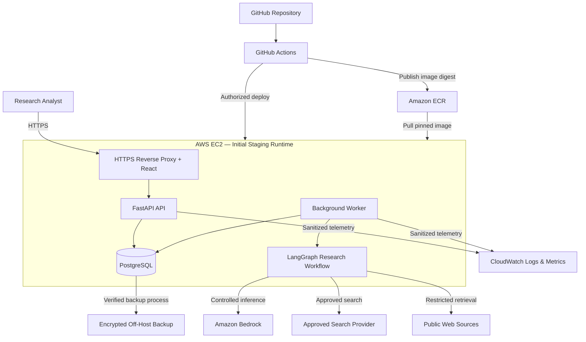
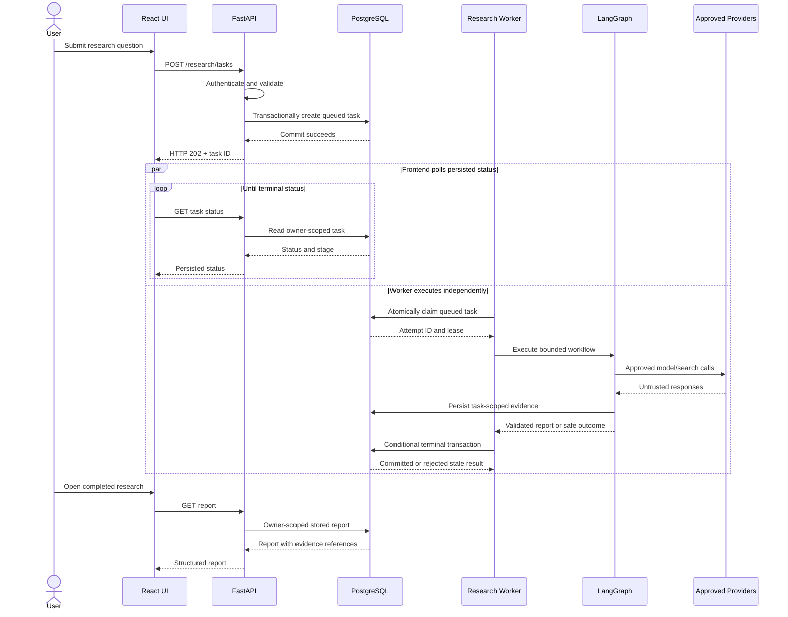
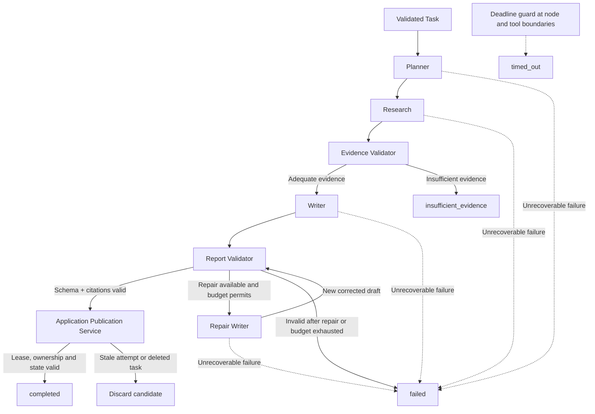
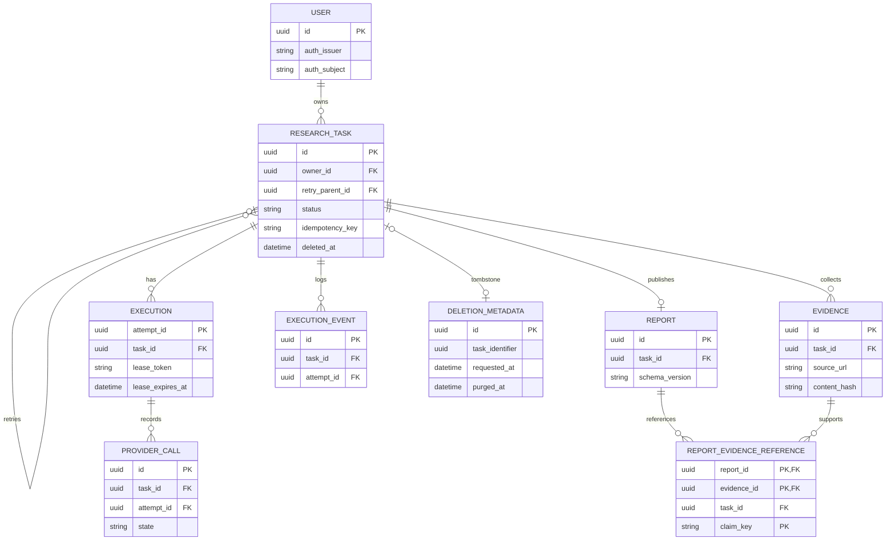
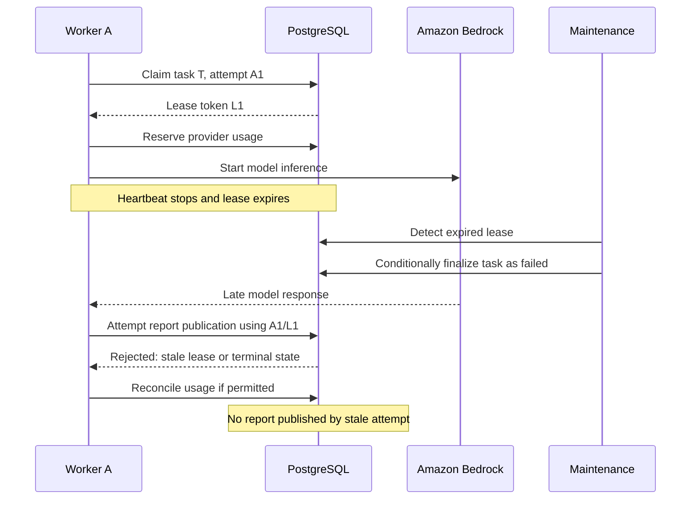

# AgentOps AI — System Architecture

> **Active S06 amendment — S06-AMEND-001:**
> S06 Contract v1.1 is approved for the offline
> Development MVP deliverable only. The approved
> amendment and revised milestone allocation supersede
> conflicting historical S06 scope descriptions.
> Original product requirements, security gates,
> and historical verification remain preserved.
> External execution remains denied.
> Production remains NOT APPROVED.

## S06-AMEND-001 — Approved Contract v1.1

Recorded at: 2026-11-25T12:36:32.255498+00:00.

Status: APPROVED — Development MVP only.

S06 deliverable: Offline Evidence and Citation Foundation.

Authoritative contract and acceptance matrices:
docs/sprints/S06.md.

- Original v1.0 acceptance: 18 VERIFIED, 4 PARTIAL,
  1 PENDING_CI, 1 PENDING_OWNER.
- Effective v1.1 local assessment: 22 VERIFIED,
  1 PENDING_CI, 1 PENDING_OWNER.
- Original security ledger: 13 VERIFIED, 3 PARTIAL.
- Partial security gates: SG06, SG08 and SG10.
- Official final owner acceptance: 0/24, pending closeout.
- Deferred obligations: six, all OPEN.
- Runtime source and tests unchanged.
- Live execution denied.

| ID | Obligation | Original traceability | Receiving milestone | Status |
| --- | --- | --- | --- | --- |
| D06-01 | Provider interoperability | AC05 | S08 | OPEN |
| D06-02 | Secure connector verification | AC07, SG06, SG08 | S07 | OPEN |
| D06-03 | External execution budgets and deadlines | AC09, SG10 | S07 | OPEN |
| D06-04 | Actual provider usage and cost accounting | AC05, AC09, SG10 | S08 | OPEN |
| D06-05 | Real evidence integration | AC05 and real-data obligations of AC11-AC20 | S08 | OPEN |
| D06-06 | Integrated external security acceptance | AC21, SG01-SG16 | S08 | OPEN |

### Mandatory release restrictions

This amendment does not authorize live provider
execution, actual credential access, paid inference,
paid search, PAYG, shared database migrations,
worker activation, real-user authentication,
report publication or production deployment.

External execution remains unconditionally denied
throughout S06 delivery.

All S02-S06 security gates remain mandatory.
SG06, SG08 and SG10 remain PARTIAL in the original
security ledger until successor evidence resolves
their outstanding obligations.

A controlled live smoke test requires separate
explicit authorization after applicable transport,
budget and security prerequisites have been verified.

Routine external execution requires completed
applicable security verification and its own
explicit activation approval.

Preserve the strict Authlib security XFAIL,
approved dependency manifests, canonical worktree
and all prior release restrictions.

Production remains NOT APPROVED.

### Architecture scope reconciliation

S06 implements an offline evidence foundation in
the existing modular monolith.

The versioned S06 graph consumes validated synthetic
evidence, not unrestricted external provider output.

Application-owned acquisition services enforce
permissions and bounded operations outside the graph.

The application evidence repository uses scoped
owner, task and isolated execution identifiers.

Isolated execution identifiers do not establish
durable worker fencing or recovery semantics.

Repository scope checks do not constitute database
row-level security.

S07 must establish authorized durable execution,
recovery, lease/fencing behavior and bounded
acquisition under its separately approved contract.

D06-02 and D06-03 are S07 obligations.

S08 must reconcile real provider interoperability,
actual usage accounting, real evidence integration
and external security acceptance.

D06-01, D06-04, D06-05 and D06-06 are S08 obligations.

The original architecture and ADR boundaries remain
in force. No external activation, new dependency,
shared schema mutation or worker execution is
authorized by this documentation amendment.

### Approved revised milestone allocation

| Sprint | Deliverable |
| --- | --- |
| S00 | Product planning and architecture — CLOSED |
| S01 | Application foundation — CLOSED |
| S02 | Database and authentication — CLOSED |
| S03 | Research task API and dashboard — CLOSED |
| S04 | LangGraph workflow baseline — CLOSED |
| S05 | Specialized agent nodes — CLOSED |
| S06 | Offline Evidence and Citation Foundation |
| S07 | Worker Reliability and Secure Acquisition |
| S08 | Live Research Integration, Evaluation and Security |
| S09 | CI/CD and AWS Staging Preparation |

The project retains ten planned sprints, S00-S09.
The one-day sprint target is subject to workload
review and is not a completion guarantee.

S07 retains its original reliability, deadline,
recovery and usage-budget objectives, and receives
D06-02 and D06-03.

S08 retains its original evaluation, integration and
security objectives, and receives D06-01, D06-04,
D06-05 and D06-06.

S08 external execution depends on applicable S07
connector and execution verification.

S09 staging readiness depends on applicable S07
and S08 delivery, operational and security evidence.

Deferred obligations are mandatory. They must not
be discarded or further deferred without a recorded
owner-approved amendment.

| Field | Value |
|---|---|
| Document version | 1.1 |
| Status | Proposed — Ready for Engineering Review |
| Product | AgentOps AI |
| Sprint | S00 |
| Date | 2026-11-21 |
| Product requirements | [PRD v0.2](../product/PRD.md) |
| Primary decision | [ADR-0001 — Modular Monolith](../adr/0001-architecture.md) |
| Owner | AI Engineering |

> **Architecture status:** This document describes the proposed architecture. It does not claim that components are implemented, performance targets have been met, or AWS deployment is production-ready.
>
> **Source of truth:** The PRD defines product requirements. Approved ADRs define architecture decisions. Implementation changes must remain consistent with both.

---

## 1. Architecture Overview

AgentOps AI is a production-oriented market research application that uses a bounded LangGraph workflow to collect evidence from approved sources and generate structured reports with inspectable citations.

The architecture is designed around five principles:

1. **Correctness before complexity:** Begin with a bounded workflow, not an unrestricted autonomous agent swarm.
2. **Durable application state:** PostgreSQL owns accepted tasks, execution attempts, evidence, and reports.
3. **Separation of responsibilities:** The API receives requests; workers execute long-running research.
4. **Deterministic security boundaries:** Authorization, budgets, publication and tool permissions are enforced outside model control.
5. **Observable operations:** Failures, retries, costs, deadlines and releases must be measurable.

### 1.1 Delivery Milestones

| Milestone | Required outcome |
|---|---|
| A — End-to-End MVP | Working research flow with React, FastAPI, LangGraph, PostgreSQL, deterministic tests and Docker |
| B — AWS Staging | Versioned deployment, HTTPS, secure configuration, recovery, monitoring and backup verification |
| C — Controlled Pilot | Security review, quality evaluation, retention, incident handling, load testing and release approval |

The architecture is intentionally designed to support the later milestones without implementing every operational feature in Sprint S01.

### 1.2 Architectural Style

**Modular monolith with separate execution processes.**

The API and worker share a versioned backend codebase and domain interfaces. They are deployed as separate processes but are not independently deployed microservices.

This choice is documented in ADR-0001.

---

## 2. System Context and Trust Boundaries

### 2.1 Actors and External Services

| Actor/System | Responsibility |
|---|---|
| Research Analyst | Create tasks, inspect progress, review owned reports |
| Platform Operator | Configure providers, monitor operations, manage releases |
| React UI | Collect input, display status, reports and evidence |
| FastAPI | Authentication integration, validation, authorization and task APIs |
| Worker | Durable claiming, workflow execution and recovery |
| PostgreSQL | Authoritative application persistence |
| LangGraph | Typed workflow orchestration |
| Amazon Bedrock | LLM inference through a controlled adapter |
| Search Provider | Public information discovery through an approved adapter |
| Public Websites | Untrusted research source content |
| Amazon ECR | Versioned container artifacts |
| CloudWatch | Sanitized logs, metrics and alarms |

The authentication provider, search provider, Bedrock model and AWS region remain pending architecture decisions.

### 2.2 Trust Boundaries

**Browser → API**

Client input is untrusted. User identity must be established through verified authentication and never accepted from client-supplied owner identifiers.

**API/Worker → Database**

Application services enforce lifecycle and ownership. Foreign keys, uniqueness constraints and transactional writes provide additional safeguards.

**Worker → LangGraph/LLM**

Model outputs are proposals or data, not authorization decisions. They must pass schema and application policy validation.

**Worker → External Sources**

Search results, URLs, redirects, DNS responses, page text and metadata are untrusted.

**CI/CD → AWS**

Deployment identities must have limited permissions, use temporary credentials where possible and remain separate from runtime identities.

**Logs/Backups**

Operational logs and backups are independent copies of data. They require controlled access, retention and deletion procedures.

---

## 3. Technology Stack and Responsibilities

| Layer | Technology | Responsibility |
|---|---|---|
| Frontend | React, TypeScript | Research dashboard and report viewer |
| API | Python, FastAPI, Pydantic | Validated HTTP contracts |
| Domain Services | Python | Business rules and lifecycle |
| ORM | SQLAlchemy | Database access |
| Migrations | Alembic | Schema versioning |
| Database | PostgreSQL | Tasks, evidence, reports, queue and leases |
| Agent Orchestration | LangGraph | Bounded research workflow |
| Model Integration | LangChain / Bedrock adapter | Structured model inference |
| Web Research | Approved search/retrieval adapters | External evidence |
| Containers | Docker | Reproducible application artifacts |
| Local Runtime | Docker Compose | Isolated services |
| Cloud Runtime | AWS EC2 initially | Staging deployment |
| Registry | Amazon ECR | Versioned image storage |
| Observability | Structured logs, CloudWatch | Metrics and diagnostics |
| CI/CD | GitHub Actions | Automated verification and release |

Version and dependency locking will be established during implementation.

---

## 4. Modular Monolith Boundaries

### 4.1 Backend Modules

| Module | Owns |
|---|---|
| Identity | Verified user identity and session integration |
| Research | Research task creation, ownership, history and lifecycle |
| Execution | Queue admission, worker leases, attempts, budgets |
| Workflow | LangGraph state, nodes and graph routing |
| Evidence | Sources, excerpts, normalization and provenance |
| Reporting | Report schemas, validation and publication |
| Providers | LLM, search and retrieval interfaces |
| Operations | Health, telemetry, recovery and retention |

### 4.2 Dependency Rules

- HTTP routers call application services.
- Services may coordinate repositories through an explicit unit of work.
- Graph nodes use approved application interfaces and provider adapters.
- Graph nodes cannot directly change task ownership or bypass budget enforcement.
- Only the lifecycle service changes task status.
- Only the report publication service commits a completed report.
- Cross-module communication uses Python interfaces, not internal HTTP.
- Provider-specific response types do not leak into domain models.
- Shared transactions must use consistent lock ordering.

### 4.3 Deployment Processes

The same backend artifact runs with different entry points:

- **API process:** Short-lived HTTP requests.
- **Worker process:** Task claiming, heartbeats and LangGraph execution.
- **Maintenance process:** Recovery and retention operations, either as a dedicated process or controlled worker responsibility.

On initial single-host staging, the number of active maintenance instances must be controlled to avoid duplicate sweeping.

---

## 5. System Architecture Diagram

### Design Notes

- PostgreSQL and internal application ports are not publicly exposed.
- The reverse proxy is the public application entry point.
- ECR images are referenced by immutable digest at deployment time.
- External content is accessed only through approved adapters.
- The diagram does not represent a highly available architecture.
- The database residing on the same EC2 host is an initial cost-conscious deployment decision, not a long-term availability recommendation.

---

## 6. End-to-End Research Sequence

The API request, frontend polling and worker execution are independent activities.

The API must commit the task before returning HTTP 202.

Frontend polling never starts or owns the research execution. Closing the browser does not cancel an accepted task.

The worker may finish while the browser is disconnected. The resulting terminal state remains stored until deletion or retention expiry.

---

## 7. FastAPI API Boundaries

### 7.1 Proposed Endpoints

| Method | Endpoint | Purpose |
|---|---|---|
| GET | `/api/v1/health` | Application liveness |
| GET | `/api/v1/ready` | Database and schema readiness |
| POST | `/api/v1/research/tasks` | Create research task |
| GET | `/api/v1/research/tasks` | Paginated owned history |
| GET | `/api/v1/research/tasks/{task_id}` | Status and execution metadata |
| GET | `/api/v1/research/tasks/{task_id}/report` | Stored structured report |
| GET | `/api/v1/research/tasks/{task_id}/evidence` | Paginated evidence |
| POST | `/api/v1/research/tasks/{task_id}/retry` | Create linked retry |
| DELETE | `/api/v1/research/tasks/{task_id}` | Request deletion |

Authentication-specific routes are deferred to ADR-0002.

### 7.2 Contract Rules

- Authentication and authorization run server-side.
- Research submission is asynchronous and returns HTTP 202.
- An idempotency key is required for submission.
- Identical replay returns the existing task.
- Conflicting payloads under the same key return HTTP 409.
- Invalid fields return HTTP 422.
- Missing or invalid authentication returns HTTP 401.
- Inaccessible resources return a consistent HTTP 404.
- Over-capacity requests return HTTP 429 with safe retry guidance.
- Dependency unavailability returns HTTP 503.
- Error responses include a stable code, safe message and request ID.
- Collection endpoints use stable pagination.
- Frontend polling stops at terminal outcomes.
- Stored reports are never regenerated as a side effect of viewing them.

Deletion may return HTTP 202 only after logical deletion and execution invalidation are committed.

---

## 8. LangGraph Architecture

### 8.1 Graph Objective

Implement a small, typed, bounded workflow:

`Planner → Research → Evidence Validator → Writer → Report Validator`

The graph orchestrates research behavior. It does not own user authorization, the durable task queue, or report publication.

### 8.2 Typed State

| Field | Purpose |
|---|---|
| `task_id` | Stable application task ID |
| `attempt_id` | Execution fencing ID |
| `question` | Validated research question |
| `scope` | Validated research boundaries |
| `plan` | Structured subquestions and queries |
| `evidence_ids` | References to persisted evidence |
| `coverage` | Gaps, conflicts and unavailable sources |
| `draft_report` | Unpublished structured candidate |
| `validation_result` | Validation outcome |
| `stage` | Current workflow stage |
| `repair_used` | Global bounded repair indicator |
| `budget_snapshot` | Non-authoritative execution limits |
| `error_category` | Safe machine-readable error |
| `versions` | Graph, model, prompt and schema versions |

Credentials, raw private configuration, hidden chain-of-thought and unnecessary full source pages must not be stored in graph state.

### 8.3 Node Contracts

**Planner**

Input: Validated research task.

Output: A schema-valid research plan.

Allowed operations: Bounded model inference.

**Research**

Input: Plan and approved provider context.

Output: Evidence references and coverage metadata.

Allowed operations: Approved search, restricted retrieval and budgeted model calls where justified.

**Evidence Validator**

Input: Evidence references and research scope.

Output: Structured sufficiency assessment.

Allowed operations: Task-scoped reads, deterministic provenance and format checks.

**Writer**

Input: Research plan and valid evidence.

Output: Structured report draft.

Allowed operations: Bounded model inference using approved evidence.

**Report Validator**

Input: Draft report and persisted evidence.

Output: Schema and citation validation result.

Allowed operations: Deterministic checks and task-scoped evidence resolution.

**Repair Writer**

Input: Failed draft, validation errors and approved evidence.

Output: Corrected draft.

Allowed operations: One additional authorized model call within global budgets.

### 8.4 Corrected Workflow Diagram

### 8.5 Repair Limits

A task may use at most **one malformed-output repair** across the entire workflow.

If the Planner consumes the repair allowance, the Writer cannot receive an additional repair.

A repair must actually generate a corrected candidate before revalidation.

Transient provider retries are separate from malformed-output repair but still consume global tool/model budgets and deadlines.

No unlimited graph cycles are permitted.

### 8.6 Execution Limits

The initial PRD hypotheses are:

| Limit | Default |
|---|---|
| Planned subquestions | 4 |
| Model invocations | 8 |
| Search calls | 6 |
| Retrieval calls | 12 |
| Evidence records | 20 |
| Total model tokens | 40,000 |
| Estimated variable cost | USD 1.00/task |
| Model timeout | 45 seconds |
| Search/retrieval timeout | 15 seconds |
| Running deadline | 180 seconds |
| Queue wait | 60 seconds |
| Retries per eligible operation | 1 |

Application services must enforce limits before provider dispatch.

A graph node cannot increase its own budgets or permissions.

### 8.7 Terminal Outcomes

- `completed`: Valid report published.
- `insufficient_evidence`: Evidence cannot support a suitable report.
- `failed`: Unrecoverable execution or validation failure.
- `timed_out`: Queue or running deadline exceeded.

These are application lifecycle states. The graph returns an outcome proposal; the application lifecycle service applies the authoritative transition.

### 8.8 LangGraph State vs Application State

| Storage | Authority |
|---|---|
| ResearchTask | User-visible lifecycle, ownership and deletion |
| Execution | Attempts, leases, deadlines and budgets |
| Evidence | Persisted provenance and source references |
| Report | Validated published output |
| LangGraph State | In-memory or persisted execution working state |
| Optional Checkpoints | Workflow snapshots, not queue admission |

LangGraph checkpoints do not replace durable queue claiming or transactional report publication.

Mid-graph resume is deferred. Interrupted MVP workflows may safely fail and require an explicit new retry task.

If checkpoints are later enabled, they must be tied to task and attempt identifiers, governed by retention, and validated before resumption.

---

## 9. PostgreSQL Logical Data Model

### 9.1 Core Tables

**users**

- `id` UUID primary key
- `auth_issuer`
- `auth_subject`
- Minimal account metadata
- `created_at`
- Unique `(auth_issuer, auth_subject)`

**research_tasks**

- `id` UUID primary key
- `owner_id` foreign key
- `question`
- `scope` JSONB
- `status`
- `stage`
- `idempotency_key`
- `request_fingerprint`
- `retry_parent_id`
- `created_at`, `started_at`, `completed_at`
- `error_category`
- `deleted_at`
- Unique `(owner_id, idempotency_key)`

**executions**

- `attempt_id` UUID primary key
- `task_id` foreign key
- `worker_id`
- `lease_token`
- `lease_expires_at`
- `heartbeat_at`
- `deadline`
- Graph/model/prompt versions
- Usage counters and reservations
- `ended_at`

**evidence**

- `id` UUID primary key
- `task_id` foreign key
- `source_url`
- `retrieved_url`
- `title`
- `excerpt`
- `acquisition_method`
- `retrieved_at`
- `published_at` nullable
- `content_hash`

**reports**

- `id` UUID primary key
- `task_id` unique foreign key
- `schema_version`
- Structured summary/findings/synthesis
- Limitations
- `generated_at`

**execution_events**

- `id`
- `task_id`
- Optional `attempt_id`
- Event type and stage
- Timestamp and duration
- Sanitized error category

**deletion_metadata**

- `id`
- Retained non-content task identifier
- Deletion request timestamp
- Purge timestamp
- Restore-suppression expiry

### 9.2 Supporting Tables

**report_evidence_references**

- `report_id`
- `task_id`
- `evidence_id`
- `claim_key`

Composite foreign keys must ensure cited evidence belongs to the same task as the report.

A unique report constraint prevents duplicate final publication.

**provider_calls**

- `id`
- `task_id`
- `attempt_id`
- Provider, operation and retry ordinal
- Reserved tokens and estimated cost
- Returned usage if available
- State: reserved, succeeded, failed or unknown
- Sanitized failure category

**queue_control**

A minimal coordination record used to serialize global admission and claiming decisions.

This is not a second queue store.

### 9.3 Entity Relationship Diagram

The DeletionMetadata relationship is logical. Its tombstone record may outlive the associated ResearchTask and must not be removed through automatic cascading deletion.

### 9.4 Database Integrity

Required constraints include:

- Unique user-scoped idempotency keys.
- One published report per task.
- At most one active execution per task.
- Foreign keys between task, evidence, report and execution.
- Composite task-aware citation constraints.
- Task-and-attempt-aware provider-call references.
- Indexed queue eligibility and lease expiry.
- Indexed owner history queries.
- Valid status values and timestamps.

Use PostgreSQL integration tests for concurrent claiming and publication. SQLite is insufficient to validate the required locking behavior.

### 9.5 Transactions

Important atomic operations:

1. Accept research task.
2. Claim task and start execution.
3. Reserve provider usage.
4. Mark deletion and invalidate execution.
5. Publish report and terminal state.
6. Apply recovery decisions.

Transactions must remain short. Never hold database locks during model inference, HTTP requests or web retrieval.

---

## 10. Durable Background Worker Design

### 10.1 Submission

The API must:

1. Authenticate the caller.
2. Validate the request and idempotency key.
3. Check for an existing matching submission.
4. Enforce admission capacity.
5. Insert a queued task.
6. Commit the transaction.
7. Return HTTP 202 with task ID.

If commit fails, the API must not acknowledge successful submission.

### 10.2 Atomic Claiming

Workers claim work using PostgreSQL transactions and row locking, including `FOR UPDATE SKIP LOCKED` where appropriate.

The claim transaction must:

- Enforce global and per-user concurrency limits.
- Select a non-deleted eligible queued task.
- Respect queue expiry.
- Assign a unique execution attempt.
- Create an unpredictable lease token.
- Set deadline and lease timestamps.
- Commit before contacting external providers.

Admission and claiming concurrency decisions must be serialized consistently, without holding locks during execution.

### 10.3 Lease and Heartbeat

Initial proposed settings:

| Setting | Proposal |
|---|---|
| Heartbeat interval | 10 seconds |
| Lease lifetime | 30 seconds |
| Recovery sweep interval | 10 seconds |

These values belong to the detailed worker ADR and require testing.

Application writes must verify:

- Task ID
- Attempt ID
- Lease token
- Lease validity
- Current running state
- Task not deleted
- Deadline not exceeded

### 10.4 Recovery

If the API restarts, queued tasks remain persisted.

If a worker crashes, its active task cannot remain `running` indefinitely.

A recovery process inspects stale leases and deadlines:

- Expired queue wait → `timed_out`.
- Running deadline exceeded → `timed_out`.
- Worker interrupted with expired lease → `failed`, with a safe interruption category.
- Explicit retry → new linked task and new budget.

Automatic resumption of the exact interrupted LangGraph node is not required for MVP.

### 10.5 Worker Lease Expiry During Bedrock Inference

This failure scenario is a required integration test.

**Scenario**

1. Worker A claims task T with attempt A1 and a 30-second lease.
2. Worker A reserves a provider call and sends an inference request to Bedrock.
3. Worker A's heartbeat stops because of process interruption or loss of execution progress.
4. The lease expires while the provider request may still be running.
5. Maintenance marks the task with a safe terminal failure or timeout.
6. Bedrock returns a response to the old attempt, if the process is still able to receive it.
7. Worker A tries to persist evidence or a report.

**Required behavior**

- The database rejects the old attempt's writes because its lease is no longer valid.
- No invalid transition from `failed` or `timed_out` back to `completed` is allowed.
- No late result may create a published report.
- A later explicit retry receives a distinct task ID and fresh attempt ID.
- The original provider request is not assumed to have been canceled.
- Reserved usage remains recorded conservatively when actual billing is unknown.
- A provider response arriving late may reconcile usage only through a narrowly authorized accounting path, never through report publication.
- Terminal state and report uniqueness constraints prevent duplicate publication.

The system cannot promise exactly-once execution or exactly-once billing for external model calls.

### 10.6 Late-Result Fencing Diagram

### 10.7 Transactional Publication

The publication service must:

1. Lock the task and active execution.
2. Recheck attempt ownership and lease.
3. Recheck deadline, status and deletion.
4. Validate report schema.
5. Resolve citation IDs against evidence belonging to the task.
6. Insert the report and citation references.
7. Transition the task to `completed`.
8. End the execution and record terminal event.
9. Commit atomically.

A transaction failure must leave no partially published report.

---

## 11. Provider Adapter Interfaces

### 11.1 Model Provider

Inputs:
- Prompt version
- Validated task context
- Structured output schema
- Model identifier
- Token cap
- Timeout and budget authorization

Outputs:
- Structured candidate
- Provider request ID
- Token usage, when available
- Normalized provider error

### 11.2 Search Provider

Inputs:
- Validated query
- Approved filters
- Result limit
- Timeout

Outputs:
- Title
- URL
- Snippet
- Source metadata
- Retrieval label
- Usage metadata

### 11.3 Retrieval Provider

Inputs:
- Approved public URL
- Retrieval policy

Outputs:
- Requested URL
- Final validated URL
- Bounded excerpt
- Content type
- Retrieval timestamp
- Retrieval outcome

### 11.4 Policy Layer

Before every external operation:

- Verify active attempt and permissions.
- Calculate remaining deadline.
- Reserve call count, token estimate and cost.
- Reject operations outside budget.
- Dispatch the call outside the transaction.
- Reconcile actual usage when available.

### 11.5 Test Providers

Deterministic fixtures must implement the same contracts.

Ordinary CI must not require live web access, Bedrock credentials or paid inference.

---

## 12. Authentication and Authorization

Authentication details remain pending ADR-0002.

The chosen solution must support:

- Verified user identity.
- Stable issuer/subject mapping.
- Session expiration.
- Logout behavior.
- Secure token/cookie management.
- Protection from relevant CSRF threats.
- Owner-scoped authorization.

Authorization rules:

- Never trust client-supplied `owner_id`.
- Check ownership before reading task metadata.
- Check ownership before reading reports and evidence.
- Verify parent ownership during retry.
- Apply deletion visibility checks.
- Avoid inconsistent access errors that reveal private identifiers.

Worker access uses service-level permissions but remains scoped to the claimed task and attempt.

---

## 13. Security Architecture

### 13.1 Prompt Injection

External text must be treated as data, never as system instructions.

Controls include:

- Separate trusted instructions from retrieved content.
- Validate tool calls and arguments.
- Restrict tools at the application layer.
- Prevent model output from changing budget limits.
- Avoid including credentials in prompt context.
- Test malicious snippets, metadata and page text.

### 13.2 SSRF Protection

The retrieval adapter must:

- Permit public HTTP(S) destinations only.
- Reject URL credentials and unsupported schemes.
- Validate IPv4 and IPv6 addresses.
- Block loopback, link-local, private, metadata and other non-public destinations.
- Validate DNS results and redirect destinations.
- Prevent DNS rebinding between validation and connection.
- Preserve correct TLS hostname validation.
- Restrict response size, decompression, redirects and timeout.
- Avoid forwarding credentials or cookies to retrieved sites.

A simple URL allowlist check before an uncontrolled HTTP request is insufficient.

### 13.3 Secrets and AWS Access

- No secrets committed to Git.
- No production credentials in model prompts.
- Prefer short-lived AWS credentials and instance roles.
- Separate deployment and runtime IAM permissions.
- Limit Bedrock permissions to approved models.
- Restrict access to secrets, backups and telemetry.
- Maintain documented rotation procedures.

### 13.4 Data Isolation

- Owner-scoped database queries.
- Task-aware evidence constraints.
- Sanitized public API errors.
- Explicit test coverage for cross-user identifiers.
- No unnecessary research content in logs.

### 13.5 Safe Rendering

Reports must use structured frontend components.

Do not execute model-generated scripts or raw HTML. If Markdown is later enabled, raw HTML must be disabled and links validated.

---

## 14. Observability and Cost Controls

### 14.1 Correlation Identifiers

Track:

- Request ID
- Research task ID
- Execution attempt ID
- Provider call ID
- Deployment version
- Graph version
- Prompt version
- Model version

### 14.2 Metrics

Measure:

- Queue depth and queue age
- Task completion/failure rates
- Stage duration
- Provider latency and errors
- Retry counts
- Timeout counts
- Expired leases
- Token usage
- Estimated variable cost
- Cleanup lag
- Database and disk health

Task IDs must not become unbounded-cardinality metric labels. They belong in logs and execution events.

### 14.3 Cost Accounting

Before each model/tool call, reserve budget using authoritative execution counters.

Usage reservations must be concurrency-safe.

An unknown provider outcome must not automatically be recorded as zero cost.

The USD 1.00 task ceiling is an estimated variable-cost limit, not a guarantee that total AWS billing cannot exceed that amount.

### 14.4 Monitoring

Initial AWS staging must provide:

- Structured application logs
- Worker health visibility
- CloudWatch metrics/alarms
- Disk and database health checks
- Deployment version tracking
- AWS budget alerts

Dashboards and alerts must be tested rather than merely configured.

---

## 15. Local Docker Compose Architecture

Proposed services:

| Service | Purpose |
|---|---|
| Web/Proxy | React frontend and API routing |
| API | FastAPI request handling |
| Worker | LangGraph execution and task processing |
| PostgreSQL | Persistent database |
| Migration Job | One-shot Alembic migration |

The API and worker use the same backend image with different startup commands.

Development and automated test configuration must not accidentally make paid model calls.

A named PostgreSQL volume preserves data across container replacement but is not a backup.

Container startup dependencies do not replace readiness checks.

---

## 16. AWS Staging Architecture

### 16.1 Initial Topology

One Linux EC2 instance hosts:

- HTTPS reverse proxy and frontend
- FastAPI container
- Background worker container
- PostgreSQL on encrypted persistent storage
- Log and metric forwarding

Other AWS components include:

- Amazon ECR for container images
- Amazon Bedrock for approved inference
- CloudWatch for operational visibility
- Protected off-host storage for database backups

### 16.2 Network and Security

- Only required public HTTP/HTTPS traffic is accepted.
- PostgreSQL is not publicly accessible.
- Internal API and worker ports are private.
- Administrative access is restricted, preferably through AWS-managed session access.
- TLS and domain configuration are verified before public staging access.
- EC2 uses an appropriate IAM instance role.
- CI deployment permissions are separate from runtime permissions.

### 16.3 Persistence

PostgreSQL data must survive container replacement.

Backups must be stored independently of the EC2 host and tested through an actual restore exercise.

Disk persistence alone is insufficient as a backup strategy.

### 16.4 Limitations

This architecture does not provide:

- Automatic failover
- Multi-AZ database availability
- High availability
- A guaranteed recovery time objective
- A production SLA

Single-host failure can interrupt every application component.

ECS, RDS and Terraform expansion may be considered after operational needs and budget justify them.

---

## 17. CI/CD and Release Engineering

### 17.1 Verification Pipeline

1. Python formatting and linting.
2. Type checks where configured.
3. TypeScript checks.
4. Unit tests.
5. PostgreSQL integration tests.
6. Deterministic LangGraph tests.
7. Authorization/security tests.
8. Dependency, secret and image scans.
9. Docker build verification.
10. Applicable frozen AI evaluations.
11. Versioned image publishing.

### 17.2 Staging Deployment

1. Select verified container image digests.
2. Confirm configuration and migration compatibility.
3. Check backup availability.
4. Stop new admission if necessary.
5. Drain or safely terminate active work within configured limits.
6. Stop incompatible worker processes.
7. Apply migrations through a controlled migration job.
8. Start the new API and worker version.
9. Confirm database readiness and worker heartbeat.
10. Run smoke tests.
11. Confirm deployed artifact digest.
12. Record release outcome.

### 17.3 Rollback

- Retain previous verified images.
- Favor backward-compatible database migrations.
- Test rollback before production/pilot deployment.
- Never assume Alembic downgrade is safe.
- Restore databases only through an explicitly approved recovery process.
- Reapply deletion suppression records before restoring user access.
- Verify health, readiness and worker recovery.

Automated production deployment is not authorized by this document.

---

## 18. Testing Strategy

### 18.1 Unit Tests

Cover:

- Input validation
- Task state transitions
- Request fingerprint generation
- Budget enforcement
- Provider error classification
- Report schema validation
- Evidence normalization
- URL policy

### 18.2 PostgreSQL Integration Tests

Verify:

- Concurrent idempotent submissions create one task.
- Conflicting idempotency keys return conflict.
- Two workers cannot claim the same task.
- Expired leases reject stale writes.
- Terminal states cannot reopen.
- Reports publish atomically.
- Cross-task citations are blocked.
- Deletion prevents late publication.
- Recovery sweeps resolve stale work.
- Migration compatibility is respected.

Use real PostgreSQL for these tests.

### 18.3 LangGraph Tests

With deterministic fixture providers, test:

- Successful bounded workflow.
- Planner schema failure.
- Research source failure.
- Insufficient evidence.
- Writer schema failure.
- One bounded repair.
- Repair exhaustion.
- Fabricated citation references.
- Global token/cost budget exhaustion.
- Deadline enforcement.
- No unbounded workflow loops.

### 18.4 Security Tests

Cover:

- Cross-user task/report/evidence access
- Expired authentication
- Unauthorized retry and deletion
- Prompt injection
- SSRF through redirects and DNS rebinding
- IPv6/private network targets
- Oversized retrieved responses
- Unsafe report rendering
- Secret leakage in logs

### 18.5 AI Evaluation

Use a versioned evaluation dataset, initially approximately 40 questions.

Compare:

1. Manual analyst work.
2. Simple model baseline.
3. Bounded AgentOps workflow.

Measure structural citation validity, groundedness, coverage, task success, latency and cost.

Maintain held-out cases and representative failure examples.

The evaluation thresholds in PRD v0.2 are hypotheses until measured.

### 18.6 Operations Testing

Before a controlled pilot:

- Kill the worker during provider inference.
- Restart API/worker processes.
- Simulate database unavailability.
- Verify stale-lease recovery.
- Verify report publication fencing.
- Restore PostgreSQL from backup.
- Test deployment rollback.
- Confirm alerts and operational evidence.

---

## 19. Risks, Limitations and Open Decisions

| Risk | Response |
|---|---|
| Single EC2 failure | Independent backups, recovery drills, honest availability limits |
| Worker crashes | Lease expiry, fencing and safe terminal outcomes |
| Duplicate tasks | Idempotency keys and database constraints |
| Paid calls after timeout | Conservative provider usage accounting |
| Fabricated citations | Task-aware deterministic validation |
| Unsupported claims | Human-groundedness evaluation |
| Prompt injection | Tool permissions outside model control |
| SSRF | Validated DNS, redirects and network destinations |
| Provider outages | Bounded retry and error classification |
| Cost overrun | Reservations, model limits and budget alerts |
| Deleted content reappearing | Tombstone ledger and restore suppression |
| Excessive complexity | Fixed graph, modular monolith, staged delivery |

### Pending Decisions

| ADR | Scope |
|---|---|
| ADR-0001 | Modular Monolith |
| ADR-0002 | Authentication |
| ADR-0003 | Async Execution and Recovery |
| ADR-0004 | LangGraph State and Agent Boundaries |
| ADR-0005 | AWS Deployment |
| ADR-0006 | Model and Search Providers |
| ADR-0007 | Data Retention and Security |

ADR-0001 is the primary design proposal in Sprint S00. Later ADRs must be created and reviewed before the corresponding implementation or release decisions are finalized.

---

## 20. Requirement Traceability

| PRD Requirement | Architecture Coverage |
|---|---|
| FR-001–FR-002 | Authentication, ownership and authorization |
| FR-003–FR-005 | Validated requests, durable submission and idempotency |
| FR-006–FR-007 | Asynchronous workers and status polling |
| FR-008 | Bounded LangGraph workflow |
| FR-009 | Approved provider interfaces and network policy |
| FR-010 | Task-scoped evidence and provenance |
| FR-011–FR-013 | Report schema, citation validation and uncertainty |
| FR-014 | Persistent history and report retrieval |
| FR-015 | Deadlines, budgets and reservations |
| FR-016 | Failures, timeouts and recovery |
| FR-017 | Explicit new-task retry |
| FR-018 | Execution telemetry and provider usage |
| FR-019 | Deletion and retention safeguards |
| FR-020 | Durable queue and interrupted-worker handling |
| NFR-001 | Modular Monolith |
| NFR-002–NFR-003 | API and research performance measurement |
| NFR-004–NFR-005 | Durability and recovery |
| NFR-006 | Security boundaries |
| NFR-007 | Observability |
| NFR-008 | Deterministic testing |
| NFR-009 | Versioned builds and migrations |
| NFR-010 | Accessible frontend |
| NFR-011 | Versioned model/graph/prompt state |
| NFR-012 | Availability measurement and limitations |

### Implementation Guidance

The first implementation milestone must deliver a small end-to-end vertical slice:

`React → FastAPI → PostgreSQL → Worker → LangGraph with Fixtures → Stored Report → React`

Do not implement every future infrastructure component during initial scaffolding.

### Architecture Review Status

**Status:** Proposed — Ready for Tech Lead review.

**Approval does not imply implementation, test completion, measured AI accuracy or production readiness.**